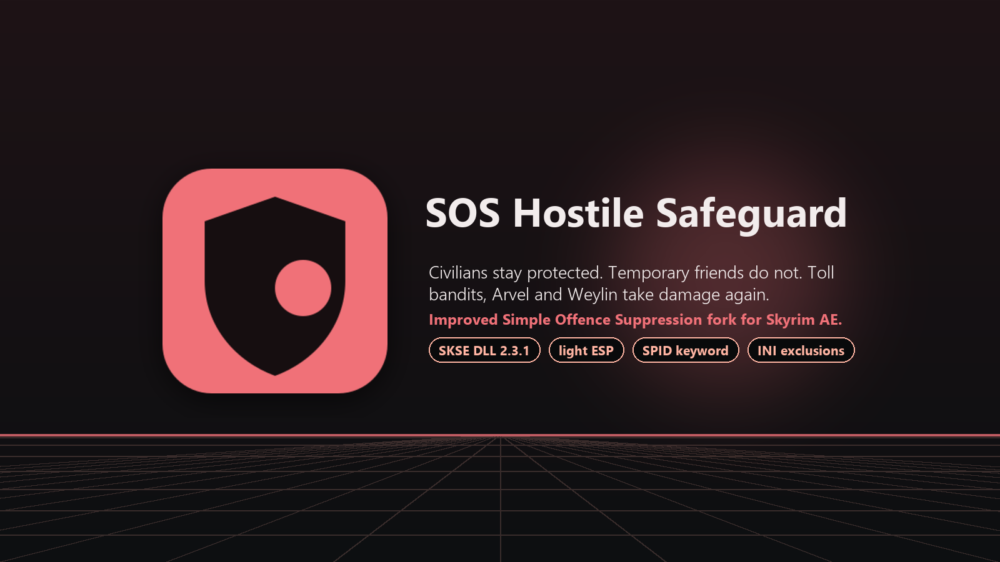
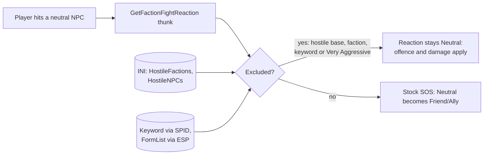

<div align="center">



[](https://github.com/SenjuWoo/SOS-Hostile-Safeguard/actions/workflows/build.yml)
[](https://github.com/SenjuWoo/SOS-Hostile-Safeguard/releases/latest)
[](source-publish/SimpleOffenceSuppression/CMakeLists.txt)
[](#requirements)
[](LICENSE)

**[Install](#install)** · **[Configuration](#configuration)** · **[Build](#build)** · **[How it works](#how-it-works)** · **[Honest status](#honest-status)** · **[Changelog](CHANGELOG.md)**

</div>

SOS Hostile Safeguard is an improved fork of powerofthree's
[Simple Offence Suppression](https://github.com/powerof3/SimpleOffenceSuppression). Stock SOS
treats any NPC who is not hostile right now as a friend when you hit them, which also shields
enemies who are only calm for a moment: paid-off toll bandits, Arvel the Swift, Weylin in the
Markarth market. This fork keeps civilians, guards and real allies protected and lets those
temporary "friends" take damage and offence again.

## What you get

- **Real foes are hittable again.** Toll bandits after you pay, Arvel (`BanditAllyFaction`) and Weylin are no longer promoted to Friend when you strike them.
- **Covers NPCs with no factions.** Weylin's base record has zero factions, so faction-only patches miss him. `HostileNPCs` lists NPC base EditorIDs the DLL never protects.
- **Data-driven lists.** `HostileFactions` and `HostileNPCs` live in the INI, so a new modded assassin needs one line, not a recompile.
- **MCM friendly fire patched, not rehosted.** The light ESP patches the SOS MCM perk so keyword-tagged hostiles take full damage; the MCM mod itself is not redistributed.
- **SPID tagging.** `SOS Hostile Safeguard_DISTR.ini` gives common hostile factions and the unique EditorIDs the exclusion keyword.
- **Very Aggressive rule restored.** Very Aggressive and Frenzied actors never get suppression, as in SOS 1.1.


No in-game screenshot is published yet; the shots above are a real local build and the real shipped files.

## Why it exists

Simple Offence Suppression, and especially
**[SOS MCM – Block Friendly Fire](https://www.nexusmods.com/skyrimspecialedition/mods/41774)**,
treats any NPC who is **not currently hostile** as a friend when you hit them. That also catches
enemies who are only calm for a moment:

| Example | Why stock SOS breaks the fantasy |
| --- | --- |
| **Toll / highway bandits** after you pay | Still bandits; surprise attacks do nothing useful |
| **Arvel the Swift** | `BanditAllyFaction`, flees with the claw, protected as a "friend" |
| **Weylin** (Markarth market, attacks Margret) | Base record has **zero factions**, so faction-only patches miss him |
| Modded / quest "talk first" foes | Neutral reaction, promoted to Friend, no damage and no offence |

Stock SOS is right for accidental hits on guards and shopkeepers. It should **not** protect
scripted assassins and paid-off bandits.

## Requirements

**Hard**

- [SKSE64](https://skse.silverlock.org/)
- [Address Library for SKSE Plugins](https://www.nexusmods.com/skyrimspecialedition/mods/32444)
- [Simple Offence Suppression MCM – Block Friendly Fire](https://www.nexusmods.com/skyrimspecialedition/mods/41774) (ESP master; this package patches its perk)

**Strongly recommended**

- [Spell Perk Item Distributor (SPID)](https://www.nexusmods.com/skyrimspecialedition/mods/36869)

**Replaced at runtime**

- The [Simple Offence Suppression](https://www.nexusmods.com/skyrimspecialedition/mods/41764) **DLL**. Never run stock and this fork side by side under the same plugin name.

## Install

1. Disable the original **Simple Offence Suppression** mod (po3).
2. Keep **SOS MCM** enabled.
3. Install the [latest release](https://github.com/SenjuWoo/SOS-Hostile-Safeguard/releases/latest) or the `release/1.0.1` tree.
4. Enable **`SOS Hostile Safeguard.esp`** (light / ESPFE) **after** SOS MCM.
5. Launch with SKSE. Optional: check the SKSE log for the Hostile Safeguard and exclusion cache lines.

```text
SKSE/Plugins/po3_SimpleOffenceSuppression.dll
SKSE/Plugins/po3_SimpleOffenceSuppression.ini
SOS Hostile Safeguard.esp
SOS Hostile Safeguard_DISTR.ini
```

## Configuration

Full key list: [`docs/CONFIGURATION.md`](docs/CONFIGURATION.md).

Cover another unique assassin:

```ini
[Exclusions]
HostileNPCs = MS01Weylin,MS13Arvel,e3DemoArvel,MyModAssassinEditorID
```

Optional SPID line:

```ini
Keyword = SOS_NoOffenceSuppression|MyModAssassinEditorID
```

| Situation | Use |
| --- | --- |
| Bandits / Forsworn / undead packs | `HostileFactions` or SPID faction lines |
| Unique with an **empty** faction list (Weylin) | `HostileNPCs` + SPID EditorID line |
| Modded assassin by EditorID | Append to `HostileNPCs` |
| Shareable extension without editing the INI | Inject into FormList `SOS_HostileFactionList` |

Restart the game after INI changes. Without SPID, the DLL's faction and NPC EditorID lists still
apply to offence reactions; MCM damage blocking may still apply to untagged uniques on the perk
path.

## Build

Tools and the longer recipe: [`docs/BUILD.md`](docs/BUILD.md).

CI (windows-2022) pins CommonLibSSE to `86eb2b853101053390a81378b6263c2911603824` because later
`dev` dropped `include/REL`. From `source-publish/SimpleOffenceSuppression`:

```powershell
git clone --depth 1 https://github.com/powerof3/CommonLibSSE.git extern/CommonLibSSE
git -C extern/CommonLibSSE fetch --depth 1 origin 86eb2b853101053390a81378b6263c2911603824
git -C extern/CommonLibSSE checkout 86eb2b853101053390a81378b6263c2911603824
git clone --depth 1 https://github.com/alandtse/CommonLibVR.git extern/CommonLibVR

cmake --preset vs2022-windows-vcpkg-ae -DCOPY_BUILD=OFF
cmake --build buildae --config Release
```

Needs Visual Studio 2022 C++ tools (v143), CMake 3.20+, and `VCPKG_ROOT` pointing at a classic
vcpkg clone. Output: `buildae\Release\po3_SimpleOffenceSuppression.dll`. Copy it over stock SOS
(same filename). `-DCOPY_BUILD=OFF` keeps the post-build step from copying into a game folder
named by `SkyrimAEPath`.

## How it works



| Component | Role |
| --- | --- |
| DLL exclusions | Skip the Neutral to Friend promotion for hostiles |
| `HostileFactions` / `HostileNPCs` INI | Data-driven lists, resolved by EditorID at data load |
| Keyword + SPID | The MCM damage block also skips tagged hostiles |
| Very Aggressive rule | Restores SOS 1.1-style behaviour for high aggression |

The hook only rewrites **Neutral to Friend/Ally** reactions. Exclusions keep the reaction Neutral
(no suppression), so real foes take offence and damage normally. Plugin sources:
`src/Hooks.cpp` (`GetFactionFightReaction` thunk, `ShouldSuppress`), `src/Exclusions.h`,
`src/Settings.h` (`[Exclusions]`), `src/main.cpp`.

## Project map

```text
README.md                 this file
LICENSE                   MIT (powerofthree + fork)
CHANGELOG.md              release notes
docs/                     BUILD, CONFIGURATION, Nexus copy
docs/images/logo.svg      mark
docs/presentation/        README cover and terminal shots
release/1.0.1/            player-facing ship tree
source-publish/
  SimpleOffenceSuppression/   forked plugin sources (no CommonLibSSE binary tree)
```

## Honest status

- Package version **1.0.1**; DLL **2.3.1**.
- Built for AE / Address Library style loading (1.6.x class runtimes).
- GitHub Actions compiles the AE preset on every push; the DLL also builds locally from the steps above.
- **In-game confirmation of every encounter is still appreciated.** Report NPCs that remain undamageable, with their EditorID if possible.
- True civilians, guards and genuine allies remain protected by design.
- Other SOS "INI-only tweaks" are unnecessary if you use this package's INI. Never load two `po3_SimpleOffenceSuppression.dll` files.

## Credits

| Credit | Contribution |
| --- | --- |
| **powerofthree** | Original Simple Offence Suppression (design, SKSE plugin, MIT source); SPID |
| **wankingSkeever** (et al.) | SOS MCM – Block Friendly Fire (perk behaviour patched, not rehosted wholesale) |
| **Ryan / CommonLibSSE lineage** | Library used by the upstream plugin family |
| **meh321** | Address Library |
| **ShugokiFable** | Hostile Safeguard fork (exclusions, unique NPC list, MCM perk patch, packaging) |

## Permissions

- Upstream SOS allows modification (MIT + Nexus modification permission).
- This repo ships **modified** DLL sources and **new** addon files only.
- Do not sell. Do not convert to other games where upstream conversion rules apply to assets.

## Links

- Upstream source: https://github.com/powerof3/SimpleOffenceSuppression
- Upstream Nexus: https://www.nexusmods.com/skyrimspecialedition/mods/41764
- Issues / PRs: this repository, for fork behaviour (Weylin, exclusions, packaging)

## License

[MIT](LICENSE): powerofthree + this fork. Release notes: [CHANGELOG.md](CHANGELOG.md).
